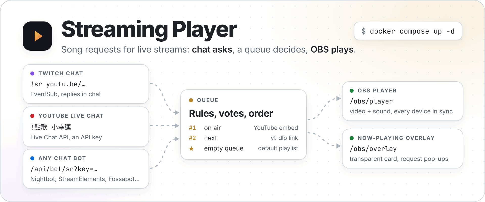
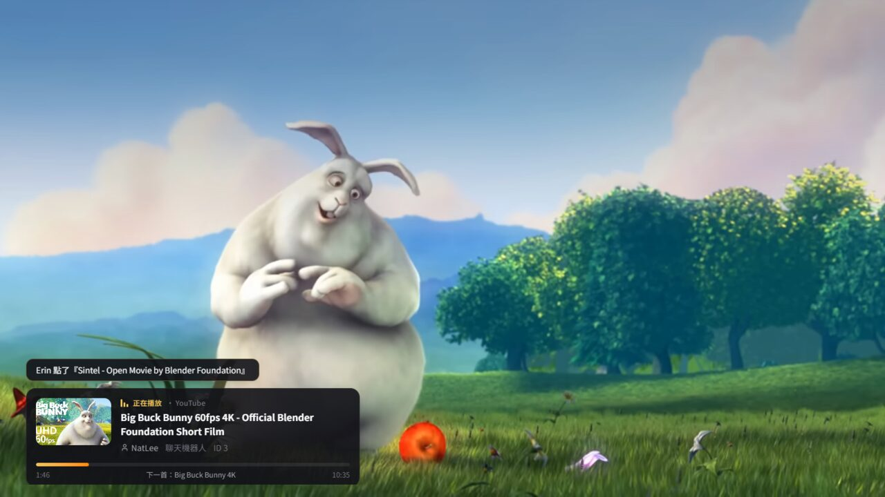
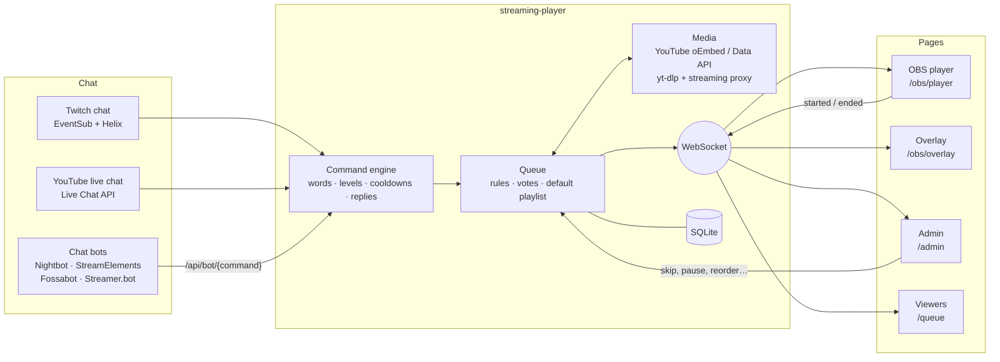
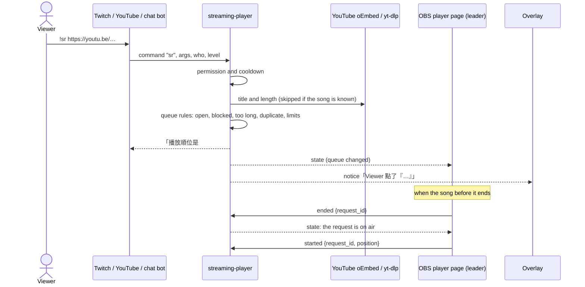
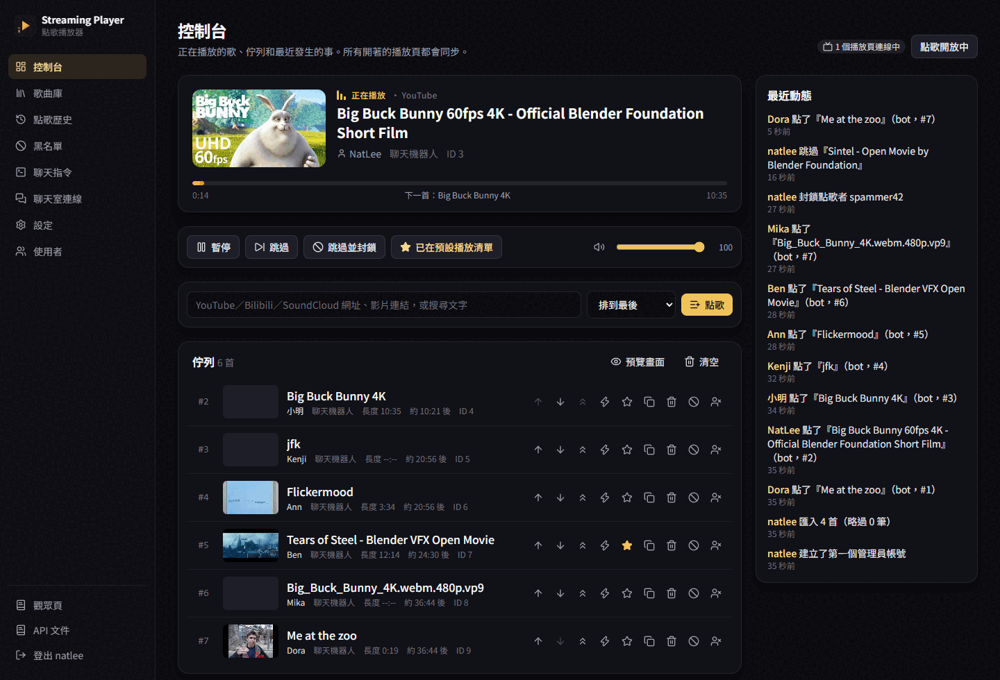
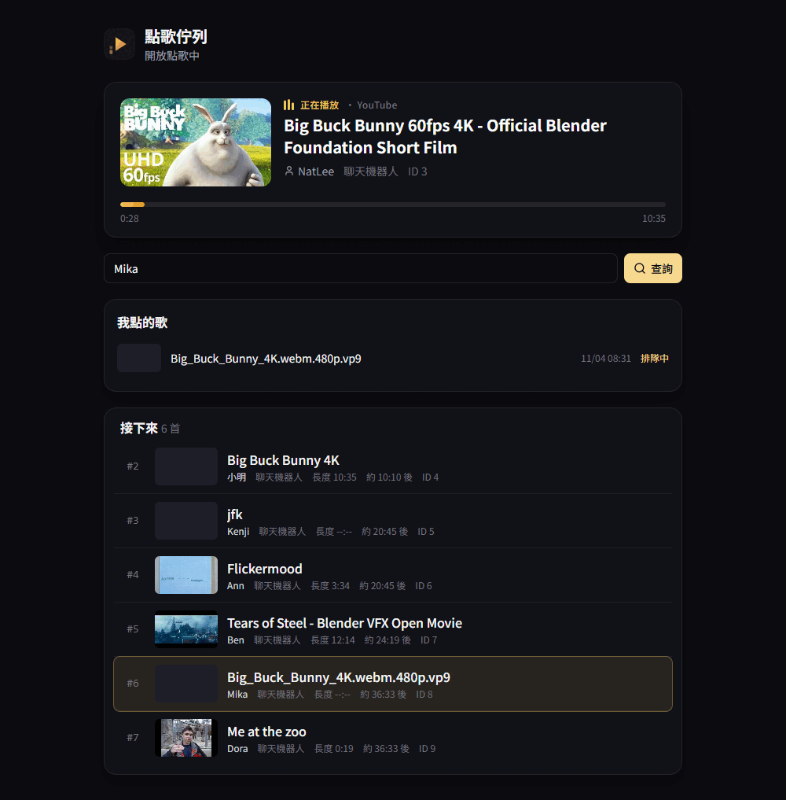
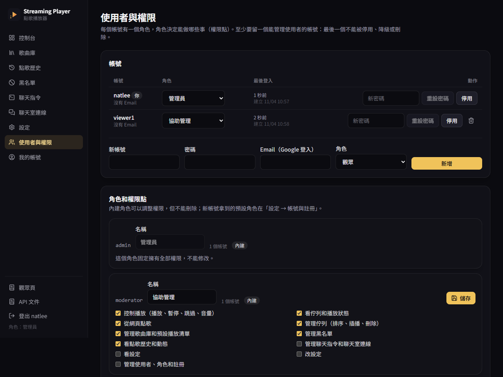
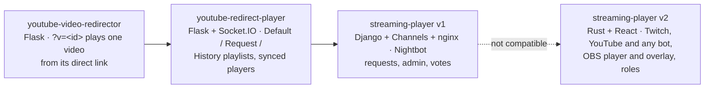

<p align="center">
  <picture>
    <source media="(prefers-color-scheme: dark)" srcset="https://raw.githubusercontent.com/NatLee/streaming-player/main/docs/images/hero-dark.png">
    
  </picture>
</p>

<p align="center">
  <a href="https://github.com/NatLee/streaming-player/actions/workflows/ci.yml"></a>
  
  
  
  
  <a href="LICENSE"></a>
</p>

Streaming Player is a self-hosted song request player for live streams. Viewers type `!sr <link>` in chat; the song joins a queue with your rules (length limit, per-person limit, cooldowns, votes, block list); an OBS browser source plays it and a transparent overlay shows what's on. It reads **Twitch** chat and **YouTube** live chat by itself, and any chat bot that can call a URL (Nightbot, StreamElements, Fossabot, Streamer.bot…) can use it too. YouTube plays in YouTube's own embedded player; Bilibili, SoundCloud, direct MP4/M3U8 links and the other sites [yt-dlp](https://github.com/yt-dlp/yt-dlp) knows play from the link yt-dlp finds.

<p align="center">
  
</p>

## What it does

- **Requests from anywhere.** Twitch chat (EventSub, replies in chat), YouTube live chat (Live Chat API with an API key), and a plain HTTP API for chat bots. All of them go through one table of commands whose words, permissions, cooldowns and reply texts you edit on the admin page.
- **A queue with rules.** Queue size, songs per person, maximum length, duplicates, vote-to-skip and vote-to-bump thresholds, a block list for people and for songs. Moderators can bypass the limits. When the queue is empty, the default playlist (your starred songs) keeps the music going.
- **Made for OBS.** A player page and a transparent "now playing" overlay, each one browser source. Every open player page stays in sync over WebSocket, and only one of them moves the queue on.
- **Control while live.** Play, pause, skip, skip and block, volume, reorder, play next, interrupt, remove, block the requester, all from the dashboard or from chat for moderators.
- **For viewers.** A public queue page (`/queue`) where anyone can look up their own requests, and (if you allow it) sign-up at `/register` to request from the web.
- **Accounts with permissions.** Roles are sets of permission points (control the player, manage the queue, the library, the block list, commands, settings, users). Admin, moderator and viewer are built in; make your own. Programs sign in with access tokens or personal API tokens.
- **Backups.** Settings, commands and the block list export to one JSON file; the song library to CSV or JSON.

## Quick start

You need Docker.

```bash
git clone https://github.com/NatLee/streaming-player.git
cd streaming-player
docker compose up -d --build
```

1. Open <http://localhost:7878/>. The first visit creates the admin account.
2. **設定 → OBS**: copy the player link into an OBS **Browser** source (1920×1080, tick **Control audio via OBS**), and the overlay link into another one (about 640×260). Details: [OBS setup](docs/obs.md).
3. Connect chat on **聊天室連線**:
   - Twitch: create a public app, paste its Client ID, press **登入 Twitch** and type the code at twitch.tv/activate. [Twitch setup](docs/twitch.md)
   - YouTube: paste an API key and the live video's URL. [YouTube setup](docs/youtube.md)
   - A chat bot: paste the ready-made command text shown there. [Chat bots](docs/chat-bots.md)
4. Try it from the dashboard's request box, or type `!sr https://youtu.be/…` in chat.

Chat bots call your server from the internet, so for them set `SP_PUBLIC_URL` to an address they can reach (behind a reverse proxy). Twitch and YouTube connections work from `localhost`.

## Example

A chat bot request is one URL. With Nightbot, a `!sr` command whose message is `$(urlfetch https://your.host/api/bot/sr?key=KEY&args=$(querystring))` answers like this (real replies from a test run; the texts are v1's and can be changed):

```text
!sr https://www.youtube.com/watch?v=aqz-KE-bpKQ
NatLee 點播了『Big Buck Bunny 60fps 4K - Official Blender Foundation Short Film』，馬上開始播放！ID是『3』

!點歌 https://commons.wikimedia.org/wiki/File:Big_Buck_Bunny_4K.webm
小明 無情點播了『Big Buck Bunny 4K』，播放順位是#3，ID是『4』，還要再等25分23秒！

!voteskip
當前的歌 [Me at the zoo] 已經被 [ Ann , Ben , Cleo ] 投票卡掉！
```

Or call it yourself:

```bash
curl "http://localhost:7878/api/bot/sr?key=KEY&user=Alice&args=https%3A%2F%2Fyoutu.be%2FjNQXAC9IVRw"
```

## How it fits together



What happens when someone types `!sr`:



More in [how it works](docs/architecture.md): the playback sync, the media paths and the WebSocket messages.

## The pages

| Admin dashboard (`/admin`) | Viewer page (`/queue`) |
|---|---|
|  |  |

The admin pages also cover the song library (default playlist, block list, songs that went missing, CSV/JSON import and export), request history with per-person statistics, the chat commands, the chat connections, settings and users. The HTTP API is in Swagger UI at `/api/docs/`.

## Chat commands

The defaults, all editable on **聊天指令** (prefix `!`, also editable):

| Command | Who | Does |
|---|---|---|
| `!sr`, `!點歌`, `!songrequest` `<link or words>` | everyone | Request a song |
| `!song`, `!現在` | everyone | What's playing, with the link |
| `!queue`, `!歌單` | everyone | Queue length, next song, viewer page link |
| `!mysongs`, `!我的歌` | everyone | Your waiting songs and their places |
| `!songstats`, `!點歌統計` `[name]` | everyone | Request statistics: total, finished, favourite song |
| `!wrongsong`, `!刪歌` `[id]` | everyone | Remove your own request (moderators: anyone's) |
| `!voteskip`, `!卡歌` | everyone | Vote to skip (3 votes) |
| `!bump`, `!插歌` `<id>` | everyone | Vote to play a song next (2 votes) |
| `!skip`, `!切歌` | moderators | Skip now |
| `!pause` / `!resume` | moderators | Pause or resume every player |
| `!songhelp` | everyone | List the commands this person may use |

## Where songs come from

| You type | Looked up with | Plays with |
|---|---|---|
| A YouTube link or id | YouTube Data API if you set a key (gives the length), otherwise YouTube's oEmbed (title only; the player reports the length) | YouTube's IFrame Player API |
| A YouTube video whose uploader disabled embedding | yt-dlp | yt-dlp's link through this server (experimental, see below) |
| Bilibili, SoundCloud, Wikimedia Commons, direct `.mp4`/`.webm`/`.mp3`/`.m3u8`… | yt-dlp | yt-dlp's link: files stream through this server, HLS plays with hls.js |
| Words | yt-dlp YouTube search (first result) | YouTube's IFrame Player API |

Tested by hand in headless Edge: a YouTube embed playing to the end and the queue moving on, a Wikimedia Commons video, SoundCloud (HLS) and Bilibili through yt-dlp. Bilibili and SoundCloud have no separate picture track the browser can use, so they play as audio with the cover art.

**YouTube from its direct link is experimental.** YouTube often refuses links that don't come from its own player, and after a burst of lookups it asks to "confirm you're not a bot" for a while. That's why YouTube metadata comes from oEmbed or the Data API, and yt-dlp is only the fallback for videos that can't be embedded.

yt-dlp ships in the image at a pinned version; **設定 → 系統 → 更新 yt-dlp** updates it when a site changes.

## Configuration

Everything you change while live (rules, commands, chat) is on the admin page. The container itself takes a few environment variables:

| Variable | Default | Meaning |
|---|---|---|
| `SP_PUBLIC_URL` | `http://localhost:7878` | The address chat bots and OBS use; shown in the ready-made links |
| `SP_BIND` | `0.0.0.0:7878` | Listen address |
| `SP_DATA_DIR` | `/app/data` | SQLite database (back up this volume) |
| `SP_TWITCH_CLIENT_ID` | | Default Twitch app client id (the admin page can set it too) |
| `SP_GOOGLE_CLIENT_ID`, `SP_GOOGLE_CLIENT_SECRET` | | Google sign-in; who may sign in follows the registration setting. Redirect URI `{SP_PUBLIC_URL}/api/auth/google/callback` |
| `SP_JWT_SECRET` | random, kept in the database | Signing key for API access tokens |
| `SP_TRUST_PROXY` | `false` | `true` when a reverse proxy sets `X-Forwarded-For` (for the registration limit) |
| `SP_COOKIE_SECURE` | `false` | `true` behind HTTPS |
| `SP_YTDLP`, `SP_YTDLP_FORMAT`, `SP_YTDLP_TIMEOUT_SECS` | image's yt-dlp, progressive HTTP first, `60` | yt-dlp executable, format selector, time limit |

Command line: `streaming-player reset-password <user> <password>`, `update-ytdlp`, `openapi`.

## Accounts, permissions and API access

Everyone who signs in has a role, and a role is a set of permission points:

| Permission | Lets you |
|---|---|
| `player.control` | play, pause, skip, volume (and be an OBS player page with your session) |
| `queue.view` / `queue.request` | watch the queue / request songs from the web page, under the queue rules |
| `queue.manage` | reorder, play next, interrupt, remove, add songs without the limits |
| `library.manage`, `blocklist.manage`, `history.view` | the song library and default playlist, the block list, history and the activity log |
| `commands.manage` | chat commands and chat connections |
| `settings.view`, `settings.manage` | read / change rules, playback, OBS key, yt-dlp |
| `users.manage` | accounts, roles, registration, the audit log |

**admin** has everything and can't be edited, **moderator** runs the player, queue, library and block list, **viewer** watches and requests. Every API and every WebSocket message checks one of these points (a test walks the whole OpenAPI document with a permission-less account), and the last account that can manage users can't be disabled, demoted or deleted. Changes to users and roles go to an audit log on the users page.



Registration (`/register`) is open by default and gives new accounts the **viewer** role; turn it off or change the role under **設定 → 帳號與註冊**, where the per-address and per-hour limits are too. Google sign-in follows the same switch: open, a first-time Google account gets an account; closed, only emails an admin entered may sign in.

For programs, every API takes `Authorization: Bearer`:

```bash
# Username and password → a 15-minute access token and a refresh token
curl -s -H 'content-type: application/json' -d '{"username":"natlee","password":"…"}' \
  http://localhost:7878/api/auth/token
# {"access_token":"eyJ…","refresh_token":"8f3…","token_type":"Bearer","expires_in":900,"refresh_expires_in":2592000}

curl -s -X POST -H "Authorization: Bearer eyJ…" http://localhost:7878/api/player/skip
```

`/api/auth/refresh` trades a refresh token for a new pair (the old one stops working) and `/api/auth/revoke` cancels one. Changing your password or being disabled signs out every session and token. For a Stream Deck or Streamer.bot button, make a **personal API token** (`spat_…`) on **我的帳號**: it never expires unless you say so, and it can only do what you ticked. Details: [users and permissions](docs/users-and-permissions.md).

## Coming from v1

v2 is not compatible with v1: the old `/player/nightbot/…` URLs and the Django database are gone. Replace each Nightbot command with the text the admin page gives you (**聊天室連線**), and rebuild the library or import it as CSV. Steps: [moving from v1](docs/migration-v1.md).

## Family tree



From [youtube-video-redirector](https://github.com/NatLee/youtube-video-redirector) v2 keeps "play this one video now": `/watch?v=<id>` plays a YouTube video without touching the queue. From [youtube-redirect-player](https://github.com/NatLee/youtube-redirect-player) it keeps the default, request and history lists (default playlist, queue, history) and players synced across devices; history is no longer capped at 200, because the statistics need all of it.

## Development

The server builds and tests in Docker; no local Rust needed.

```bash
# Server: format, lint, tests (fake yt-dlp, fake Twitch and YouTube servers)
docker run --rm -v "$PWD:/src" -w /src/src/api rust:1-trixie \
  sh -c "rustup component add rustfmt clippy && cargo fmt --check && cargo clippy --all-targets -- -D warnings && cargo test"

# Web app: tests and build (Node 24)
cd src/web && pnpm install && pnpm test && pnpm build

# Run the web app against a server on :7878 with hot reload
pnpm dev
```

The code is in `src/api` (server) and `src/web` (React). [Pitfalls](docs/pitfalls.md) lists the problems met so far.

## License

[MIT](LICENSE) © 2023 Nat Lee

## Limits and what isn't verified

- The Twitch and YouTube chat connections are tested against fake servers that follow the documented messages. They haven't been run against a real Twitch channel or a real YouTube live stream yet.
- YouTube live chat with an API key is read-only: replies can't be posted there. They show up in the activity log, and accepted requests pop up on the overlay.
- Playing YouTube from yt-dlp's direct link may fail (see above). The embedded player is the supported way.
- Bilibili plays without picture, and many of its videos are geo-restricted.
