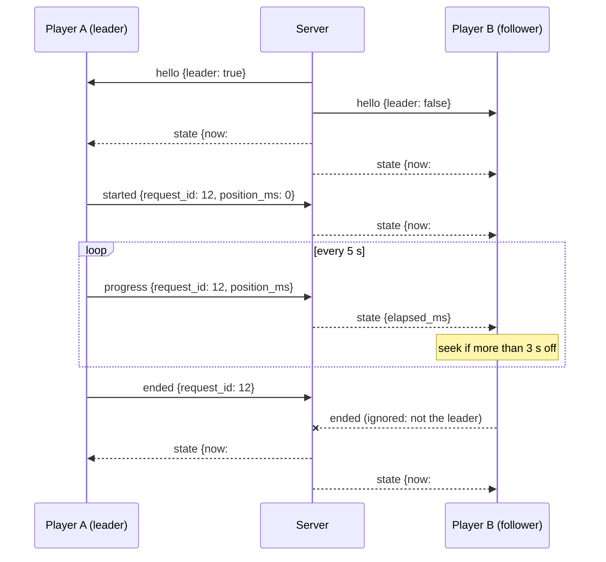

# How it works

One process (Rust, axum) serves the web app, the API, the WebSocket and the media proxy, and keeps everything in one SQLite file.

```
src/api   Rust server
  commands/  chat commands: parsing, permissions, cooldowns, reply templates
  chat/      Twitch (EventSub + Helix), YouTube live chat, chat-bot API identity
  media/     link parsing, yt-dlp, YouTube Data API, streaming proxy
  queue.rs   queue rules, order, votes, moving to the next song
  live.rs    WebSocket hub, state snapshots, player leader election
  legacy.rs  everything kept for v1 (Nightbot URLs, redirects, v1 database import)
src/web   React + Tailwind (admin, OBS player and overlay, viewer page)
```

## One command engine

Every source turns a chat message into `(who, command word, arguments)`:

| Source | Who | Level |
|---|---|---|
| Twitch EventSub | chatter login + display name | badges |
| YouTube live chat | `yt:<channel id>` + display name | owner / moderator / member flags |
| `/api/bot/{command}` | `user=` or the bot's headers | `level=` or Nightbot's header |
| v1 `/player/nightbot/…` | `user=` | everyone |

`commands::engine` then looks up the command, checks it is enabled, the level, and the per-person cooldown, runs the action, and renders the reply template for the outcome. Defaults reproduce v1's Chinese replies; every text can be changed on the admin page. Role names from all platforms go through one alias table (`models::LEVEL_ALIASES`), and bot header formats through one profile table (`chat::bots::HEADER_PROFILES`).

## The queue

`requests` rows have a status: `queued` (with a position), `playing` (at most one, enforced by a unique index), and the end states `played`, `skipped`, `removed`, `failed`. Every change:

1. takes the queue lock, so two requests can't race for the same slot,
2. writes in one `BEGIN IMMEDIATE` transaction,
3. publishes a fresh state snapshot to every WebSocket.

`queue::check` is a pure function with the rules (open, blocked user or song, missing, too long, duplicate, queue full, per-person limit), so it's tested without a database. Requests from the admin page skip the limits but not the block list.

When the queue runs dry, a random favorite (the "default playlist") plays, unless autoplay is off. The song that just ended is picked last.

## Playback and sync



- The oldest connected player page leads. Only its reports move the queue, and every report names the request, so a late or repeated `ended` changes nothing.
- The server's clock (`player.rs`) stores where the leader was and when, so a page that joins mid-song starts at the right spot.
- Pause, resume, skip and volume change the shared state, and every page follows.
- An error report (or an embed error with the fallback off) counts a failure for the song. After `missing_after_failures` failures in a row, the song is marked missing (v1 issue #2).
- Songs whose length the site didn't tell are measured by the player; if they turn out longer than the limit, they are skipped.

## Media

| Link | Metadata | Playback |
|---|---|---|
| YouTube | Data API (with a key, 1 unit) → yt-dlp → oEmbed (title only) | YouTube IFrame Player API; yt-dlp link when embedding fails or in stream mode |
| Other sites, direct files | yt-dlp | yt-dlp link: files stream through `/api/media/{id}/stream` (Range supported, the site's headers added), HLS goes to hls.js |
| Words | yt-dlp `ytsearch1:` | as YouTube |

yt-dlp runs as a child process with `--` before the URL, so chat input can never become an option. Links into private networks are refused before yt-dlp sees them. Direct links are cached for 20 minutes and fetched again once if the site answers 403/404/410.

The Docker image pins yt-dlp by version and SHA-256 and ships Deno, which yt-dlp needs for YouTube since 2025.11. The admin page can run `yt-dlp --update-to stable`; the update lasts until the container is recreated.

## WebSocket protocol (`/api/ws?role=…&key=…`)

Roles: `player` and `overlay` (OBS key or session), `admin` (session), `viewer` (public page on, or session).

Server → page:

- `{"type":"hello","conn":3,"leader":true}`
- `{"type":"state", now, queue, player, requests_open, playback, players_connected, server_time_ms}` — the same shape as `GET /api/queue`
- `{"type":"notice","kind":"request","text":"Alice 點了『…』"}` — for overlay pop-ups
- `{"type":"leader","leader":true}` — sent to player pages when the leader changes

Player → server (leader only): `started`, `progress` (`position_ms`), `ended`, `error` (`reason`), `duration` (`secs`), each with `request_id`.

## Security notes

- Web users: argon2 password hashes, HttpOnly SameSite=Lax session cookies (only their hash is stored), 5 failed sign-ins lock a name for 15 minutes.
- OBS pages and chat bots use random keys in the URL, because OBS browser sources and bots can't send cookies. Both can be regenerated.
- `Referrer-Policy: strict-origin-when-cross-origin`: the YouTube player refuses to run without a Referer (error 153).
