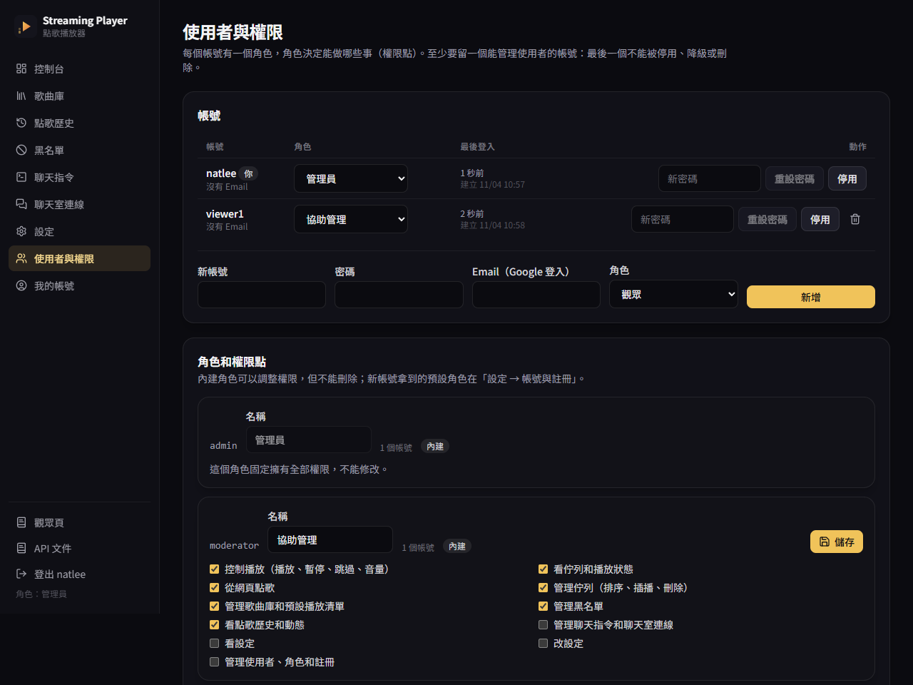

# Users and permissions

Everyone who signs in to the web page has one **role**. A role is a set of **permission points**, and every API (and every WebSocket message) checks one of them, never a role name. The server always checks; the web page also hides the buttons you can't use.

## Permission points

| Id | Lets you |
|---|---|
| `player.control` | Play, pause, skip, volume. Open `/obs/player` with your session (it reports when songs end). |
| `queue.view` | See the queue, the player state and the live updates (dashboard, overlay). |
| `queue.request` | Request songs from the web page. The queue rules apply, as for chat. |
| `queue.manage` | Reorder, play next, interrupt, remove, clear; add songs without the limits, at any place. |
| `library.manage` | The song library: add, star (default playlist), reset "missing", delete, import, export. |
| `blocklist.manage` | Block and unblock chatters and songs (also "remove and block", "skip and block"). |
| `history.view` | Request history, per-person statistics, the activity log. |
| `commands.manage` | Chat commands, Twitch and YouTube connections, the bot key, the chat prefix. |
| `settings.view` | Read settings, OBS links, system information. Download a backup. |
| `settings.manage` | Change queue rules, playback and the viewer page; new OBS key; update yt-dlp; restore a backup. |
| `users.manage` | Accounts, roles, registration settings, the audit log. |

When you save settings, each changed section needs its own point: queue rules, playback and the viewer page need `settings.manage`, chat needs `commands.manage`, accounts and registration need `users.manage`.

## Roles

| Role | Has |
|---|---|
| **admin** (管理員) | Everything. Locked: it can't be edited or deleted. The first account is an admin. |
| **moderator** (協助管理) | `player.control`, `queue.view`, `queue.request`, `queue.manage`, `library.manage`, `blocklist.manage`, `history.view`. Not users, not settings. |
| **viewer** (觀眾) | `queue.view`, `queue.request`. The default role for new accounts. |



On **使用者與權限** you can tick different points for moderator and viewer, or make your own roles (an id such as `dj`, a name, the points). A role can't be deleted while accounts use it, while it is the default role, or when it is built in.

**At least one enabled account must be able to manage users.** Disabling, deleting or demoting that account, or removing `users.manage` from its role, is refused. The check runs inside the change itself, so no order of steps gets around it.

Sign-ups, role changes, disabling, deleting, password resets, role edits and API tokens are recorded in the **audit log** at the bottom of the users page. They stay out of the dashboard's activity log, so a moderator with `history.view` doesn't see them.

## Registration

**設定 → 帳號與註冊**:

- **開放註冊** (default on): anyone can create an account at `/register`. New accounts get the **default role** (viewer unless you pick another; it can't be a role that manages users).
- **Limits**: at most 5 accounts per address and 30 in total per hour, by default. Behind a reverse proxy, set `SP_TRUST_PROXY=true` so the limit sees the visitor's address (`X-Forwarded-For`) instead of the proxy's.
- **Google sign-in** follows the same switch. When registration is open, a Google account signing in for the first time gets an account with the default role (its name comes from the email). When closed, only an email an admin entered on the users page may sign in.

The very first account (on a fresh install) always becomes the admin, whichever way it is created.

## Tokens for programs

Every API also takes `Authorization: Bearer <token>`, so scripts and tools can use it without a browser. Swagger UI at `/api/docs/` has an **Authorize** button for it.

### Access and refresh tokens

```bash
curl -s -H 'content-type: application/json' \
  -d '{"username":"natlee","password":"…"}' http://localhost:7878/api/auth/token
```

```json
{"access_token":"eyJ…","refresh_token":"8f3…","token_type":"Bearer","expires_in":900,"refresh_expires_in":2592000}
```

- The **access token** is a JWT signed with HS256, valid 15 minutes by default. Send it as `Authorization: Bearer …`.
- `POST /api/auth/refresh` with `{"refresh_token": "…"}` returns a new pair. The old refresh token stops working, so a stolen one can be used only once.
- `POST /api/auth/revoke` with `{"refresh_token": "…"}` cancels a refresh token (sign a program out).
- Changing your password, an admin resetting it, or disabling the account signs out every session, refresh token and access token at once.
- Both lifetimes are settings (**設定 → 帳號與註冊**). The signing key is made on first start and kept in the database, or set with `SP_JWT_SECRET`.

### Personal API tokens

For something that should keep working, like a Stream Deck button or a Streamer.bot action, make a **personal API token** on **我的帳號**:

- Pick a name, the permission points it may use (only ones you have), and optionally the number of days until it expires.
- The token (`spat_…`) is shown once; only its hash is stored.
- It can never do more than its owner can right now: if your role loses a point, so does the token. Disabling the account stops it.
- Revoke it on the same page. The list shows when each token was last used.

```bash
curl -s -X POST -H "Authorization: Bearer spat_…" http://localhost:7878/api/player/skip
```

## Under the hood

See [how it works](architecture.md#accounts-and-permissions). The tests in `src/api/tests/accounts.rs` cover tokens, registration, Google sign-in rules, the last-manager guard, the audit log, and a walk over every API operation with an account that has no permissions.
